# Exploring a single Standard Concept

**EHRBrowser** lets you load any standard **Concept** from the vocabulary and explore its descendants, their record and person counts over time, and how those counts break down by sex, age and visit type. This section walks through loading **Asthma (SNOMED)** as an example.

## Searching for a concept

Type `Asthma` into the search field at the top of the page. As you type, a drop-down list shows every matching **Concept**, each with its vocabulary, code and **Concept** id. Several vocabularies contain an "Asthma" code (ICD10, ICPC, SNOMED, ICD9fi, …), so check the vocabulary before choosing. Here we pick **Asthma** from **SNOMED** (code 195967001, id 317009).

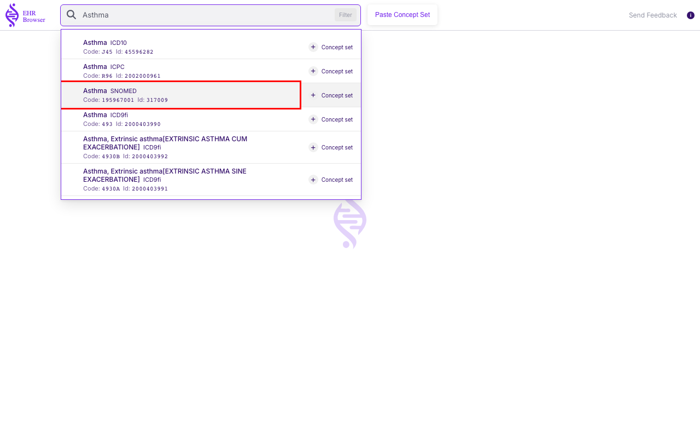

Click the entry to load the **Concept**. The page may take a few seconds to load.

## Overall view

The concept page has three areas:

- **Concept Control (top bar)**: changes the current **Concept** or switches views that affect the whole page. From here you can show the mapped concepts (Descendants / Mappings) and switch between Record Counts, Person Counts, Prevalence and Incidence.
- **Hierarchy view (left panel)**: shows how the counts are distributed across the hierarchy of the **Concept**.
- **Counts stratified view (right panel)**: shows the counts distributed by Sex, Age, Visit type and time. A Time range slider at the top limits the period shown.

### Hierarchy panel (left panel)

The left panel has three views, chosen with the selector at its top:

- **Concept Set**: the **Concept Set** expression that is being plotted.
- **List**: the descendants of the **Concept** listed by tree level, with their counts.
- **Hierarchy**: the descendants drawn as a tree.

The **Level** and **Class** filters under the selector are used to prune large trees; they are covered in the large-tree section.

#### Concept Set

**EHRBrowser** is designed to display **Concept Sets**. When you work with a single **Concept**, it is shown as a **Concept Set** that contains just that **Concept** with **Descendants** ticked, so all its descendants are included. The row shows the selected **Concept** (Asthma 195967001 SNOMED) and its **DRC** (Descendant Record Counts), here 481,732, which is also the Total Descendant Counts for the set.

#### Hierarchy tree

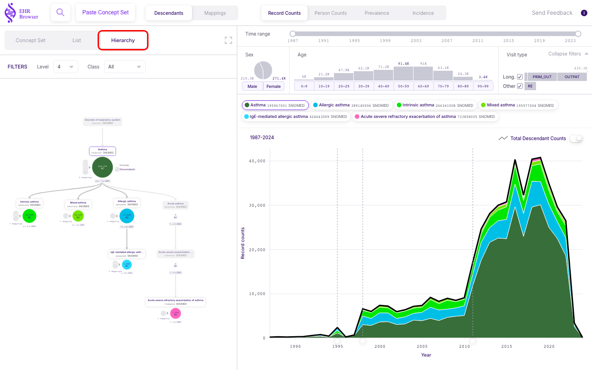

The Hierarchy view draws the descendants as a tree. The selected **Concept** (Asthma) appears on the second level. The level above shows its parent (Disorder of respiratory system), and the levels below show its descendants (Intrinsic asthma, Mixed asthma, Allergic asthma, Acute asthma and their own children).

Each node shows a circle labelled with its **RC** (Record Counts), with a size proportional to that number, and its **DRC** (Descendant Record Counts) underneath:

- **RC** is the number of times the **Concept** itself appears in the database.
- **DRC** is the number of times the **Concept** and all its descendants appear in the database.

Nodes that have no records of their own, such as Acute asthma, are shown in grey with 0 **RC** but can still have a **DRC** from their descendants.

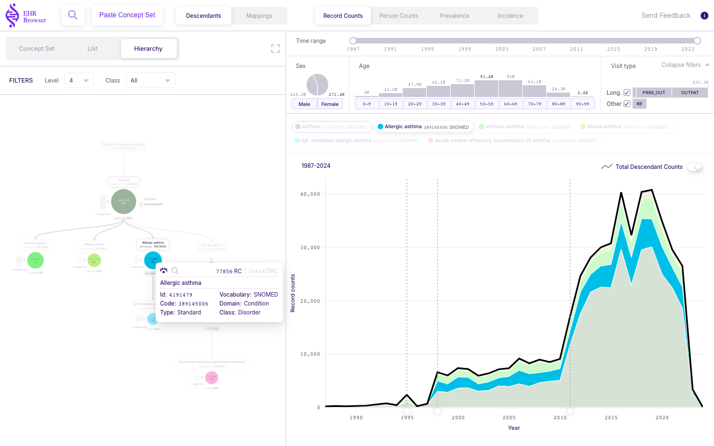

Hovering over a node opens a drop-down with more information about the **Concept**: its id, code, type, vocabulary, domain and class, plus its **RC** and **DRC**. The rest of the tree fades and the time plot on the right highlights the same **Concept**, so you can see its contribution over time. Clicking the magnifying glass in the drop-down makes that **Concept** the main **Concept** shown, so you can use the tree to navigate the hierarchy.

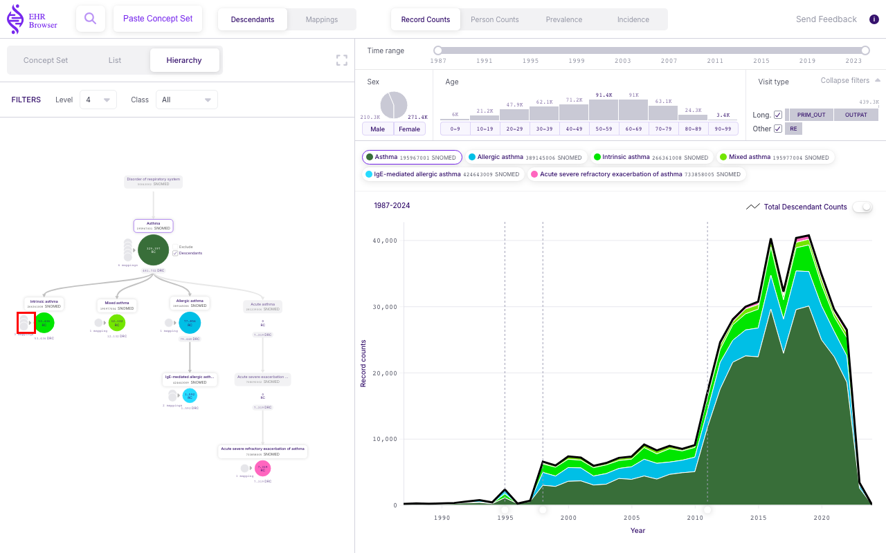

Standard **Concepts** usually have small grey circles to the left of their node. Each circle is a non-standard **Concept** that maps to this standard **Concept**, and the label beneath gives the number of mappings.

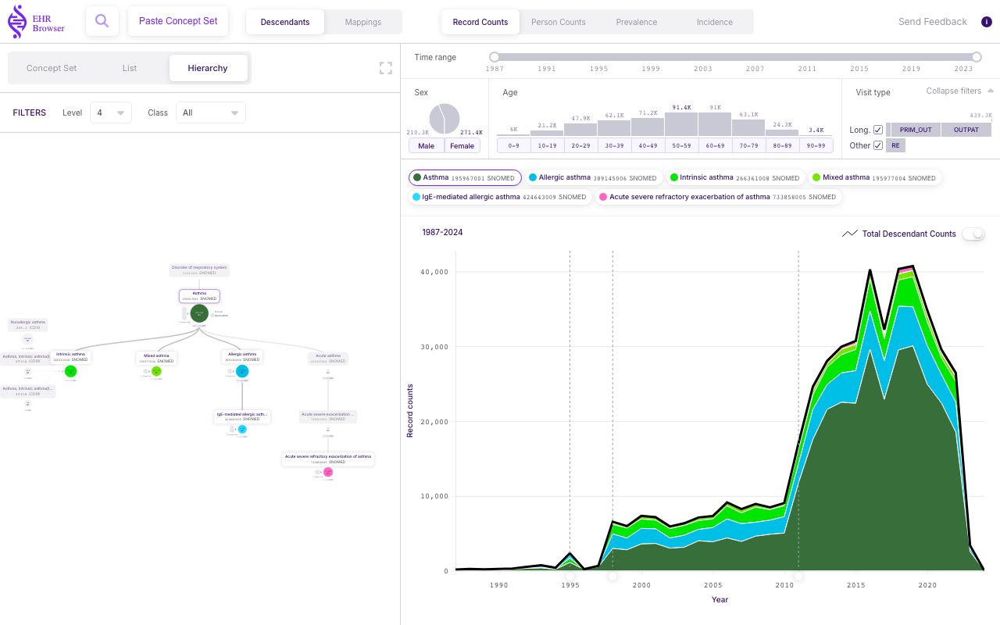

Clicking the grey circles expands the non-standard **Concepts** that map to that standard **Concept**. For Intrinsic asthma these are Nonallergic asthma (ICD10 J45.1) and two ICD9fi intrinsic asthma codes, drawn to the left of the node. The tree is rescaled to fit the extra nodes. Clicking the small x that replaces the circles closes them again.

#### List

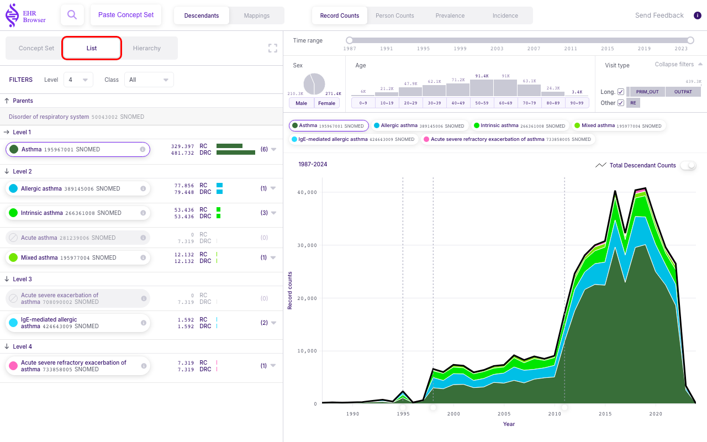

When the tree becomes too big, its nodes can be hard to see. The List view packs the same descendants into a compact list grouped by tree level (Parents, Level 1, Level 2, …). Each row shows the **Concept** with its **RC** (Record Counts) and **DRC** (Descendant Record Counts), as numbers and as small bars. The number in brackets on the right is how many non-standard **Concepts** map to it.

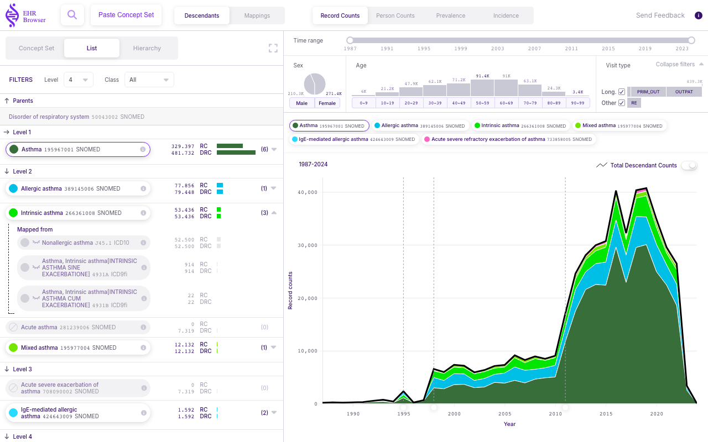

Like the grey circles in the tree view, clicking the arrow on the right of a row (next to the number of mappings) expands the non-standard **Concepts** mapped to it. They are listed under **Mapped from**, each with its own **RC** and **DRC**.

### Counts panel (right panel)

The time plot is a stacked area plot of the record counts over time for the selected **Concept** and each of its descendants. The legend above the plot lists the **Concepts** with their colours. The black line on top is the **DRC** (Descendant Record Counts) of the selected **Concept**, labelled Total Descendant Counts.

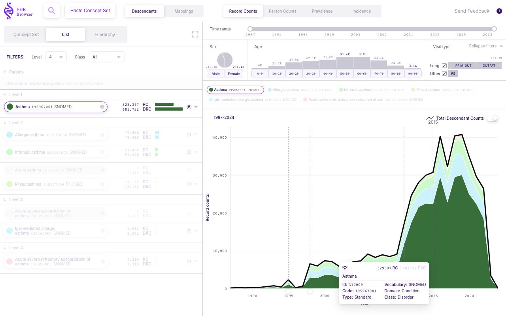

Hovering over an area highlights that **Concept**, here Asthma, in the plot, the legend and the left panel, and opens a drop-down with more information about it.

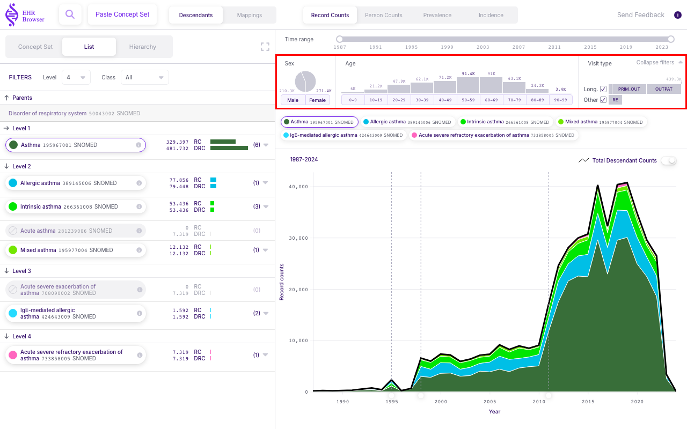

Above the time plot, the Sex, Age and Visit type charts show how the record counts are distributed across those groups. They also work as filters: clicking a value switches it on or off.

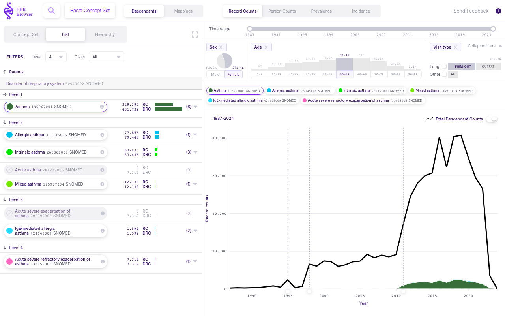

After filtering to **Female**, age **50–59** and the **PRIM_OUT** visit type, the stacked areas only show the record counts for women aged 50–59 recorded in the PRIM_OUT (primary care outpatient, 'avohilmo') register. The Sex, Age and Visit type headers each get a small x to clear that filter. The data now only covers the years that this register covers, from around 2011 onwards. The black Total Descendant Counts line still shows the unfiltered total for comparison.

### Concept Control (top bar)

The top bar controls the rest of the view. It has the search, the Paste Concept Set button, the Descendants / Mappings switch, the Record Counts / Person Counts / Prevalence / Incidence switch, and Send Feedback. Searching for another **Concept** updates the whole page to that **Concept**.

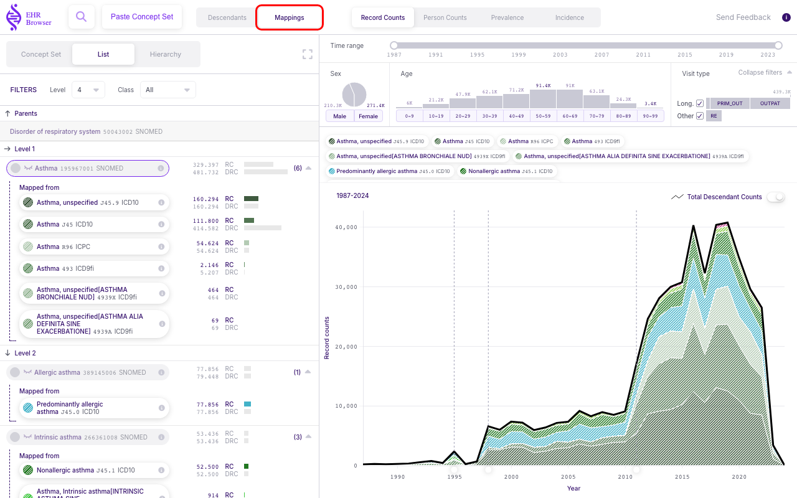

Earlier we showed how to open the mapped codes of one **Concept**. Clicking **Mappings** opens the mapped non-standard codes for every **Concept** in the tree and the list at once. The time plot then stacks the non-standard codes, shown hatched, instead of the standard ones.

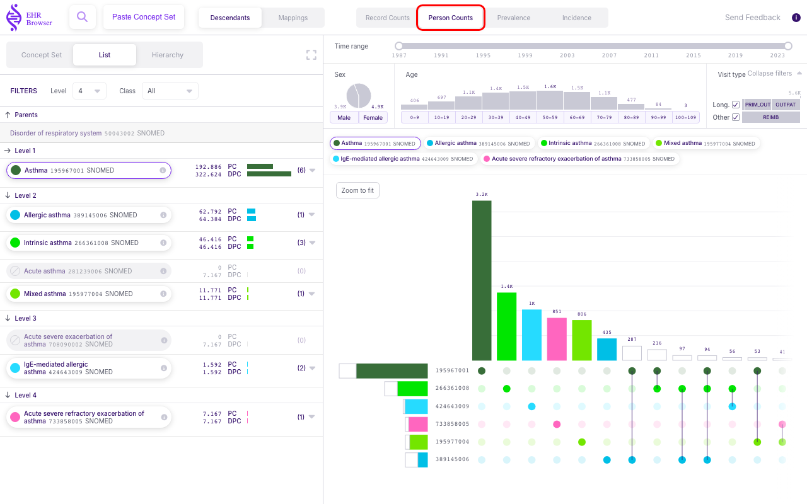

Switching to **Person Counts** shows **PC** (Person Counts) and **DPC** (Descendant Person Counts) instead of **RC** and **DRC**. The List and the Sex, Age and Visit type charts now count persons. The right panel changes from the time plot to a chart of the number of persons per **Concept** and per combination of **Concepts**, which shows how many persons have records of several of the **Concepts** at once.
