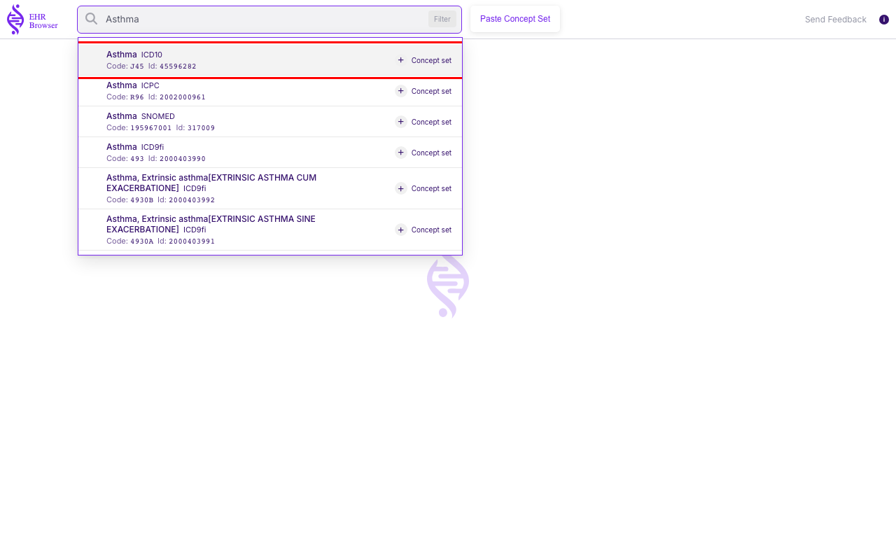
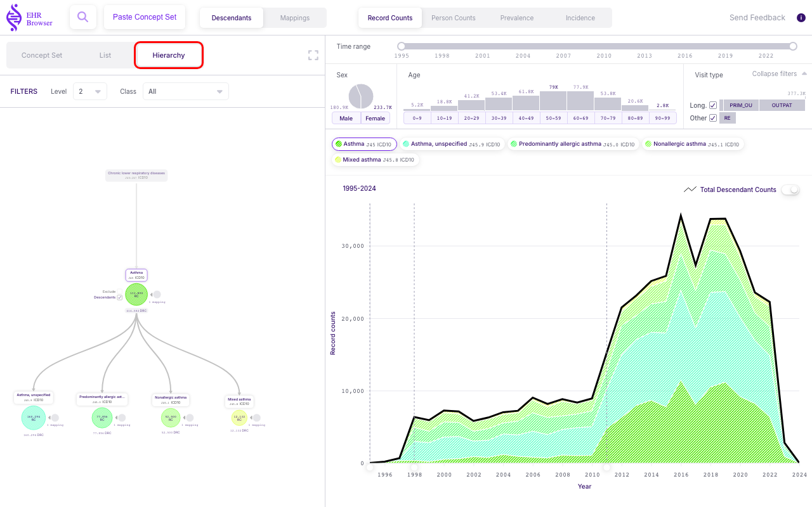
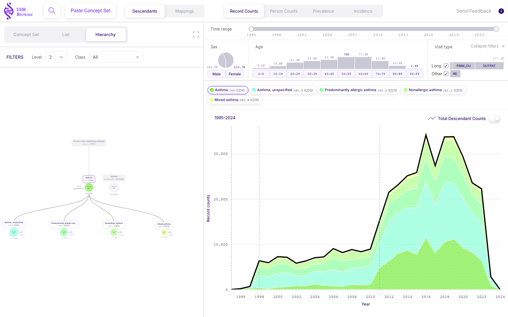
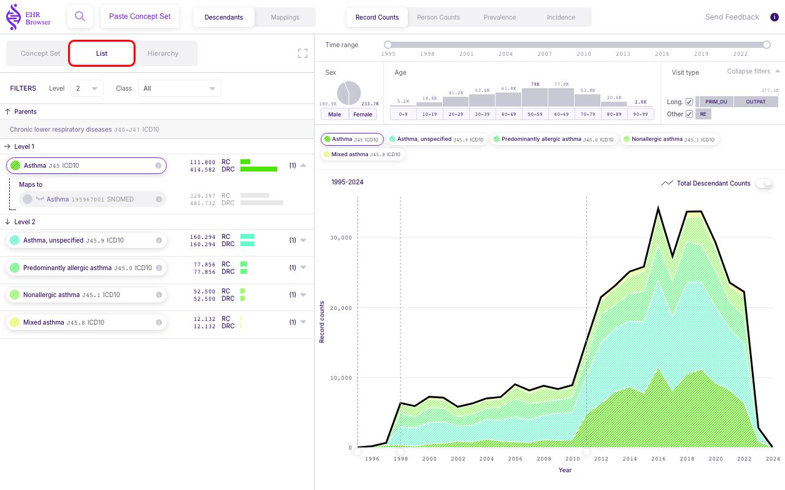

# Exploring a single non-Standard Concept

**EHRBrowser** also lets you explore non-standard **Concepts**. In **OMOP-CDM** terminology, a non-standard **Concept** is a medical code typically used in national or local settings; when conducting an international study, the equivalent standard **Concept** is used instead. Exploring non-standard **Concepts** can help you find mapping errors, or understand the code hierarchy when working on a local study. In this example we explore the non-standard ICD10 (International Classification of Diseases, 10th revision) **Concept** 'Asthma', code J45.

## Searching for a concept

As in [Exploring a single Standard Concept](../1.Exploring_a_single_standard_concept/README.md), non-standard **Concepts** can be found using the search field at the top of the page. Typing 'Asthma' lists every matching **Concept** across vocabularies; the highlighted entry is **Asthma** from the ICD10 vocabulary (Code: J45, Id: 45596282). Clicking it loads the **Concept**.

Most of the page behaves exactly as it does for a standard **Concept**. The differences appear in the hierarchy tree and the list view, described below.

### Hierarchy panel (left panel)

#### Hierarchy tree

Selecting **Hierarchy** in the left panel shows the **Concept** tree, as in section 1. The selected **Concept**, Asthma (J45), sits in the second level, with its parent, Chronic lower respiratory diseases (J40–J47), above it and its descendants (Asthma, unspecified; Predominantly allergic asthma; Nonallergic asthma; Mixed asthma) below. Each node shows its RC (Record Counts) inside a circle sized in proportion to that number, with the DRC (Descendant Record Counts) underneath.

Unlike with a standard **Concept**, the small grey circle now appears on the **right** side of each node, labelled with the number of mappings.

Clicking the grey circle next to the J45 node expands the standard **Concept** it maps to. Here, ICD10 Asthma (J45) maps to the SNOMED **Concept** Asthma (195967001), which appears as a grey node to the right of J45.

#### List

Selecting **List** shows the same **Concepts** grouped by tree level (Parents, Level 1, Level 2), each with its RC (Record Counts) and DRC (Descendant Record Counts). For non-standard **Concepts**, the arrow next to each entry expands a **Maps to** section listing the standard **Concepts** it maps to. In the picture, Asthma (J45) is expanded and shows that it maps to the SNOMED **Concept** Asthma (195967001).

The rest of the tool — the **Record Counts**, **Person Counts**, **Prevalence** and **Incidence** views, the time plot, and the Sex, Age and Visit Type filters — behaves in the same way as described in [Exploring a single Standard Concept](../1.Exploring_a_single_standard_concept/README.md).
