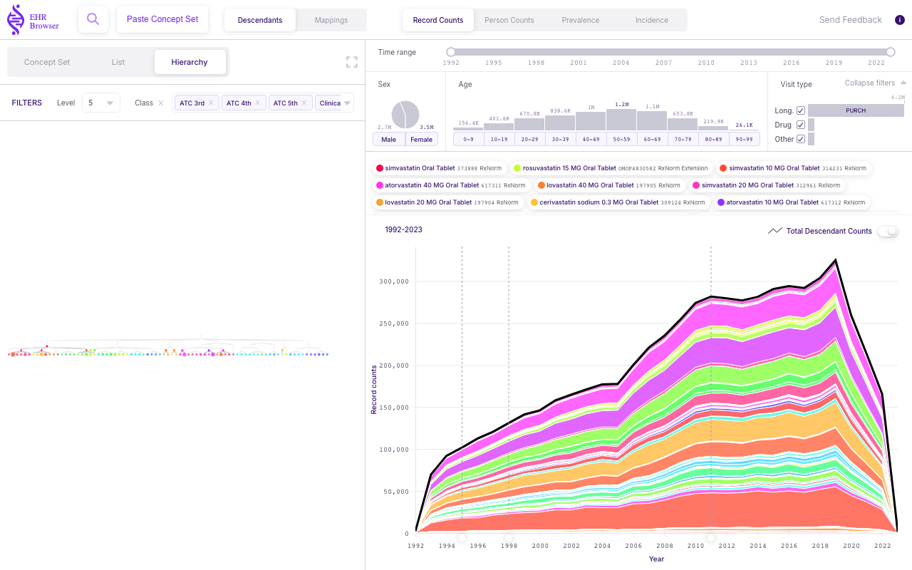
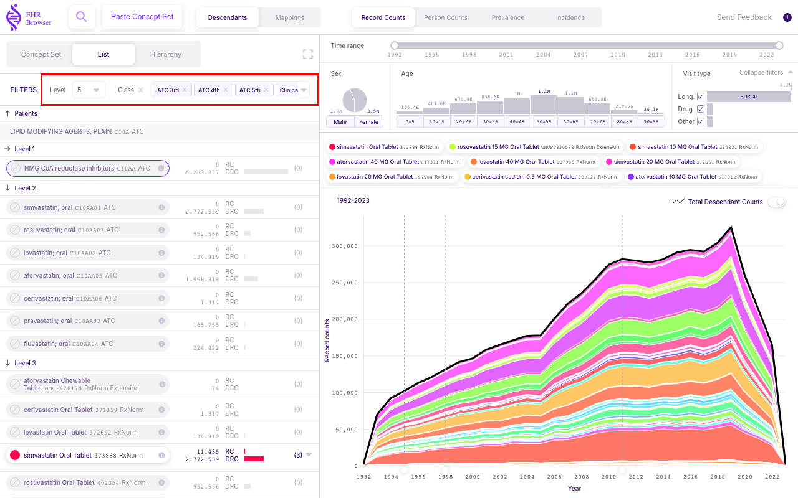
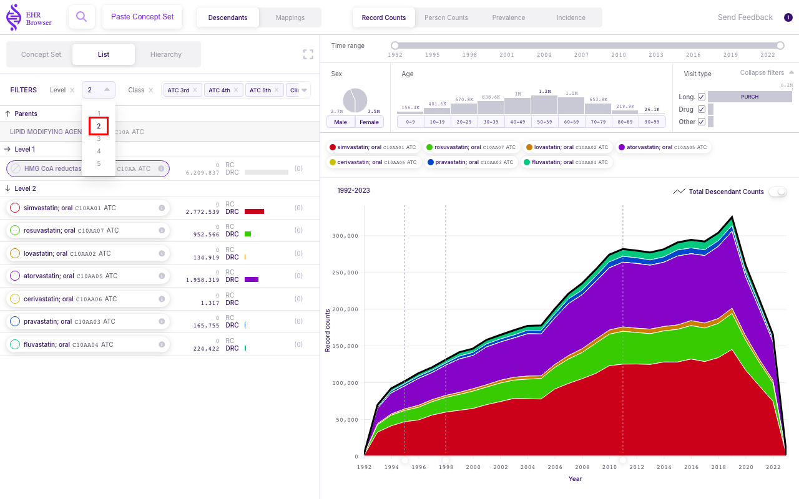
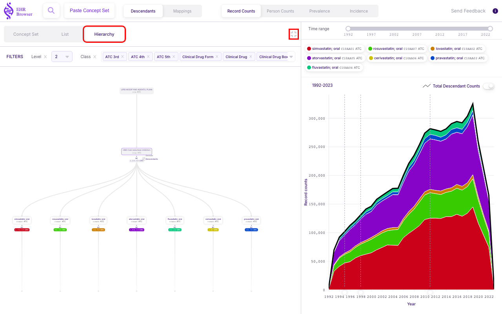
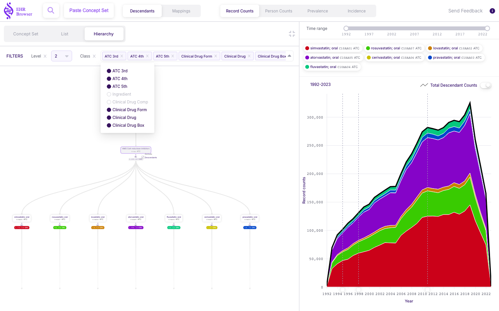
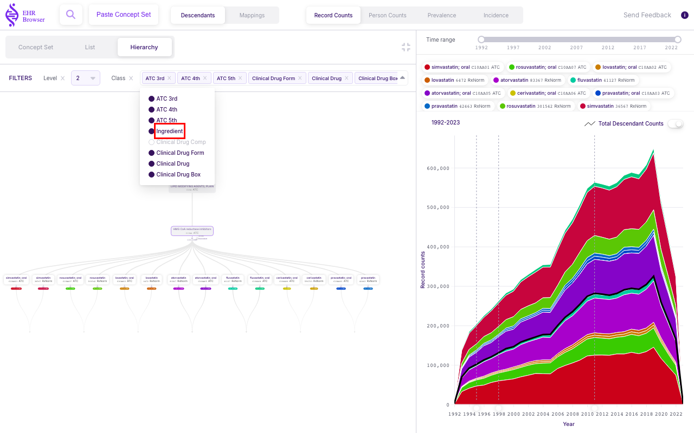

# Exploring a large tree, ATC tree example

At times, a selected **Concept** may have a large number of descendants spread across many levels. This is especially the case when exploring the ATC (Anatomical Therapeutic Chemical) tree.

The OMOP Vocabularies use ATC as a classification vocabulary: ATC **Concepts** group the more detailed RxNorm and RxNorm Extension drug vocabularies. Hence, a level 4 ATC code has as descendants its level 5 ATC codes, but also all the RxNorm codes under each level 5 ATC code, together with their own trees.

Cases like this produce trees, lists and time plots with a great many codes, which are hard to interpret. To help, **EHRBrowser** includes filters that prune the tree and simplify the visualisations. This page shows an example using the level 4 ATC code C10AA 'HMG CoA reductase inhibitors'.

## Loading ATC code C10AA 'HMG CoA reductase inhibitors'

The **Concept** can be opened directly by navigating to `http://localhost:8563/21601855`. Because of the size of its tree, it may take a while to load.

Selecting the **Hierarchy** tab shows the tree of descendants.

This **Concept** has so many descendants that the tree is drawn as a long, thin row of tiny nodes that cannot be read at this size. The time plot on the right is equally crowded: it stacks a separate coloured area for each drug **Concept**, and the legend above it lists so many drugs that it does not fit in its box. With this many layers and colours it is hard to distinguish anything.

Selecting the **List** tab gives a more compact view of the same descendants.

The list is easier to follow. Under **Level 1** is the selected **Concept**, HMG CoA reductase inhibitors (C10AA), and under **Level 2** are its direct ATC level 5 children: simvastatin, rosuvastatin, lovastatin, atorvastatin, cerivastatin, pravastatin and fluvastatin (all oral). Below these, however, the RxNorm and RxNorm Extension drug **Concepts** continue for several more levels (down to **Level 5**), adding a long list of individual products such as "simvastatin Oral Tablet" or "atorvastatin Chewable Tablet".

The **FILTERS** bar at the top of the left panel holds the two pruning tools, highlighted below.

These tools help to prune the tree:

- **Level** cuts the tree at a maximum depth. By default it is set to the deepest level of the tree (5 here).
- **Class** removes nodes by concept class. The selected classes are shown as tags (for example "ATC 3rd", "ATC 4th", "ATC 5th", …); only nodes of the selected classes are kept.

### Using 'Max Level' pruning tool

Open the **Level** dropdown and choose **2**. When the dropdown is opened again, the selected level is shown in bold.

The list is now cut to show only the selected **Concept** (**Level 1**) and its immediate ATC level 5 children (**Level 2**). The time plot changes accordingly: each area now shows the DRC (Descendant Record Counts) of one of these children, so the plot has only seven areas, one per drug group — simvastatin, rosuvastatin, lovastatin, atorvastatin, cerivastatin, pravastatin and fluvastatin. Drug utilisation over time for these groups is now much easier to interpret: for example, simvastatin and atorvastatin clearly account for most of the records.

Next, select the **Hierarchy** tab and click the expand/compress icon at the top right of the left panel to enlarge the tree.

With the tree pruned to two levels it now fits the window: the parent ATC class (LIPID MODIFYING AGENTS, PLAIN) is at the top, HMG CoA reductase inhibitors in the middle, and the seven ATC level 5 children in a single row at the bottom, each with its DRC (Descendant Record Counts) in the colour used in the time plot. Expanding the left panel gives the tree more room and hides the Sex, Age and Visit type filters, leaving the time plot on the right. Clicking the same icon again compresses the panel back.

### Using 'Classes' pruning tool

Open the **Class** dropdown.

The **Class** dropdown lists all the concept classes present in the tree. Selected classes have a filled circle; "Ingredient" and "Clinical Drug Comp" are unselected. In the OMOP Vocabularies there are different ways of grouping the highly granular drug **Concepts**. For example, the "Ingredient" class groups drugs that share the same ingredient, much as ATC level 5 does. To see what happens when both groupings are used, select "Ingredient" as well as "ATC 5th".

Once "Ingredient" is selected, both groupings are included in the tree. The second level of the tree now shows the RxNorm "Ingredient" **Concepts** alongside the "ATC 5th" **Concepts**, side by side in pairs (for example "simvastatin; oral" ATC next to "simvastatin" RxNorm), and the lines from each pair converge on the same children below. This means that the DRC (Descendant Record Counts) of both members of a pair come from the same children, so those records are counted twice. As a result, the stacked areas of the time plot now rise well above the black **Total Descendant Counts** line. This is a sign that the tree is really a graph in which children are shared.

To avoid this situation, "Ingredient" and "Clinical Drug Comp" are deselected by default.
