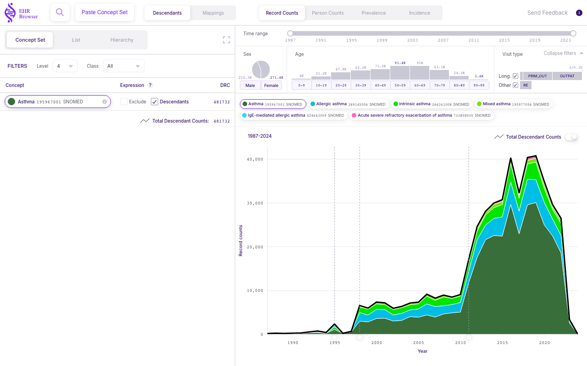
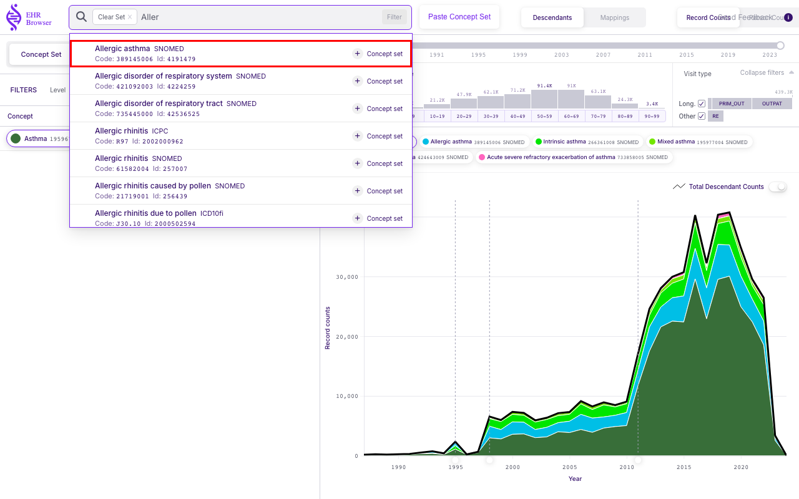
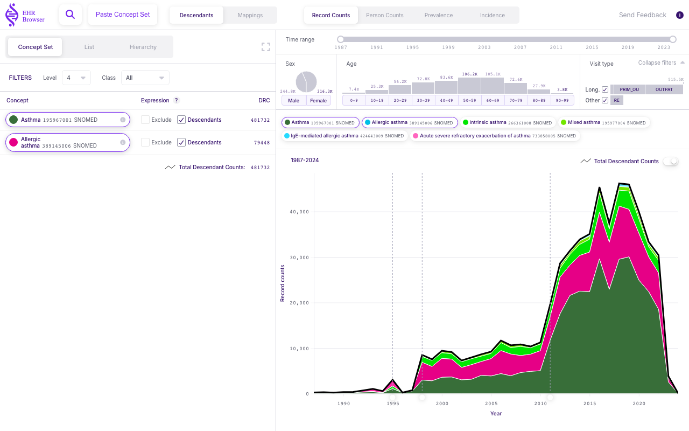
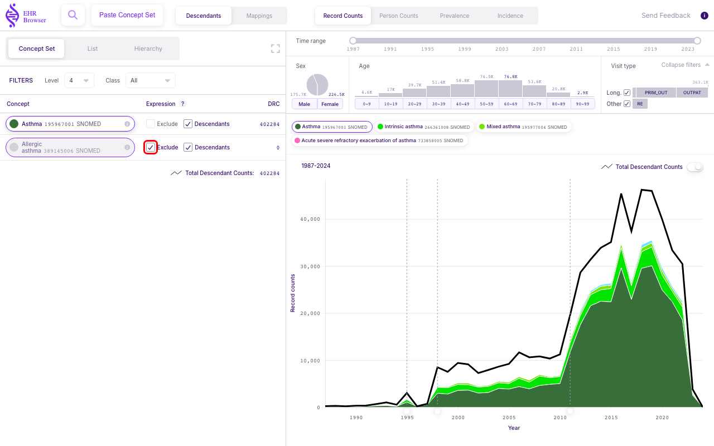
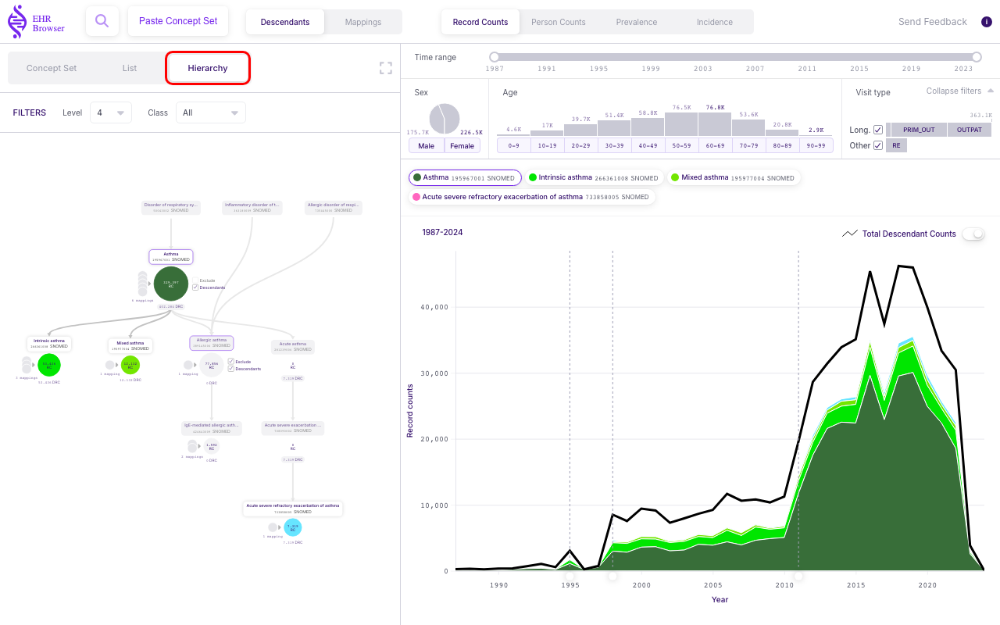
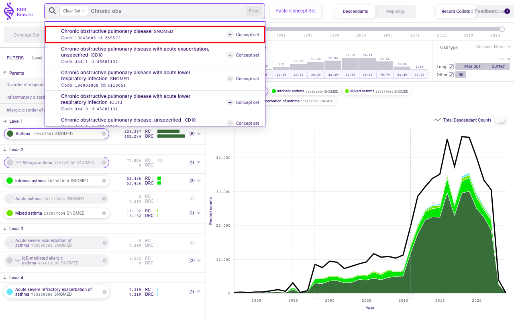
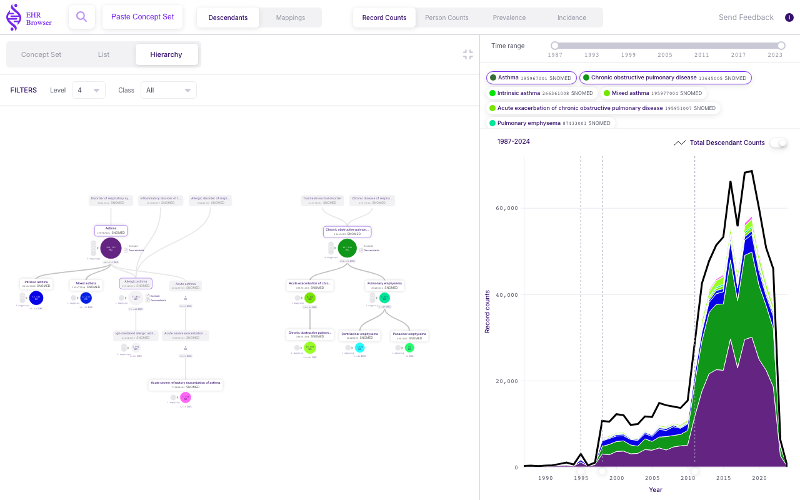
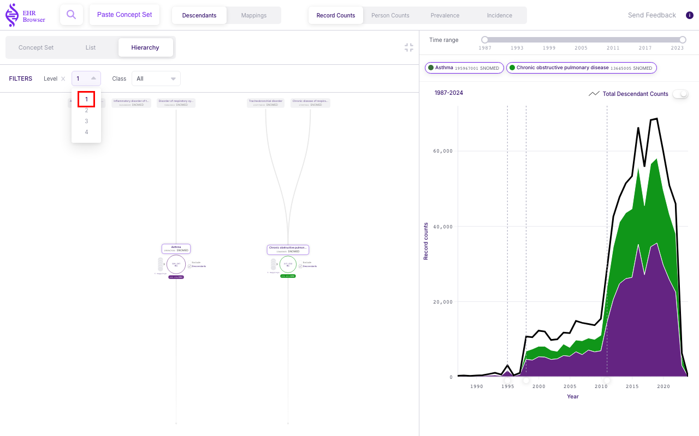
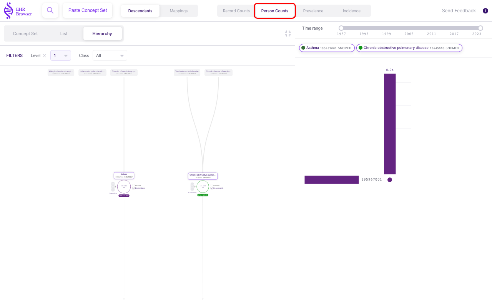

# Working with Concept Sets

In addition to looking at a single **Concept**, **EHRBrowser** allows you to build and explore **Concept Sets**. A **Concept Set** is a mechanism to create groups of **Concepts** without needing to list every code in the group. Instead, a **Concept Set** uses the code hierarchy to include whole trees of codes, or to remove specific branches from a tree. See more about **Concept Sets** in [The Book of OHDSI](https://ohdsi.github.io/TheBookOfOhdsi/Cohorts.html#conceptSets).

This section shows how to build a **Concept Set** that combines Asthma without allergic asthma with Chronic Obstructive Pulmonary Disease.

We start with the Asthma (SNOMED 195967001) **Concept** described in [Exploring a single Standard Concept](../1.Exploring_a_single_standard_concept/README.md). In the **Concept Set** view on the left, the **Concept** appears as the only row of the set. Unlike in Atlas, a **Concept** added to a **Concept Set** is included with all its descendants by default: the **Descendants** box is ticked, meaning the **Concept Set** contains the Asthma code and every code below it in the hierarchy. The DRC (Descendant Record Counts) column shows 481,732, which is also the **Total Descendant Counts** of the whole set.

Click the magnifying glass in the top bar to open the search box. When a **Concept Set** is loaded, the search box starts with a **Clear Set** button, which empties the current set when clicked. Type the new search after it — here "Aller". Each result has a **+ Concept set** button on its right: clicking it adds that **Concept** to the current set rather than replacing it. The highlighted result is Allergic asthma (SNOMED 389145006, Id 4191479).

Allergic asthma now appears as a second row of the **Concept Set**, with its own DRC (Descendant Record Counts) of 79,448. Because Allergic asthma is a child of Asthma, its records are already part of the Asthma tree, so the **Total Descendant Counts** of the set stays at 481,732.

Ticking the **Exclude** box of Allergic asthma removes it from the set. As **Descendants** is also ticked, the exclusion applies to Allergic asthma and all its descendants. The DRC (Descendant Record Counts) of Allergic asthma drops to 0 and the **Total Descendant Counts** of the set drops from 481,732 to 402,284 — exactly the 79,448 records of the excluded branch. The Allergic asthma row is greyed out, and its areas disappear from the time plot, where the black line still shows the counts before the exclusion.

Switching to **Hierarchy** shows the same effect on the tree: Allergic asthma and its child IgE-mediated allergic asthma are greyed out, meaning they are no longer included in the **Concept Set**. Both nodes show 0 DRC (Descendant Record Counts), while their RC (Record Counts) are still visible.

The same happens in the **List** view: Allergic asthma (level 2) and IgE-mediated allergic asthma (level 3) are greyed out with 0 DRC (Descendant Record Counts), and the DRC of Asthma at level 1 is now 402,284.

To add Chronic Obstructive Pulmonary Disease, open the search box again and type "Chronic obs" after the **Clear Set** button. The highlighted result is Chronic obstructive pulmonary disease (SNOMED 13645005, Id 255573); clicking its **+ Concept set** button adds it to the set.

In the **Hierarchy** view, after clicking the expand/compress icon at the top right of the left panel to enlarge it, a new tree appears next to the Asthma tree with Chronic obstructive pulmonary disease and its descendants (Acute exacerbation of chronic obstructive pulmonary disease, Pulmonary emphysema and their children). The excluded Allergic asthma branch stays greyed out in the Asthma tree. The time plot on the right now stacks the record counts of the descendants of both trees.

The pruning tools described in [Exploring a large tree, ATC tree example](../3.Exploring_a_large_tree_ATC_tree_exaple/README.md) can be used to simplify the plot.

Setting the **Level** filter to 1 cuts both trees down to their main **Concepts**. The time plot now shows only two areas — the DRC (Descendant Record Counts) of Asthma and of Chronic obstructive pulmonary disease — so the progression of the two diagnoses over time can be compared side by side.

Clicking **Person Counts** in the top bar switches from record counts to person counts. The tree nodes now show PC (Person Counts) and DPC (Descendant Person Counts) instead of RC (Record Counts) and DRC (Descendant Record Counts), and the right panel replaces the time plot with a bar chart of the number of persons per **Concept** — here a single bar for Asthma (195967001) of 8.7K persons.
