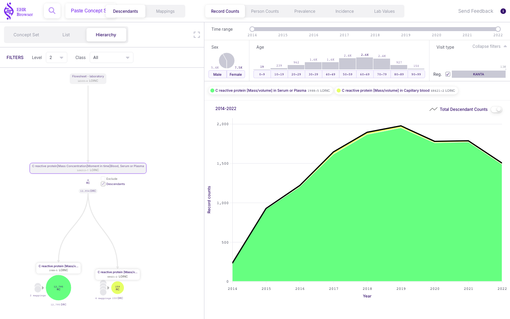
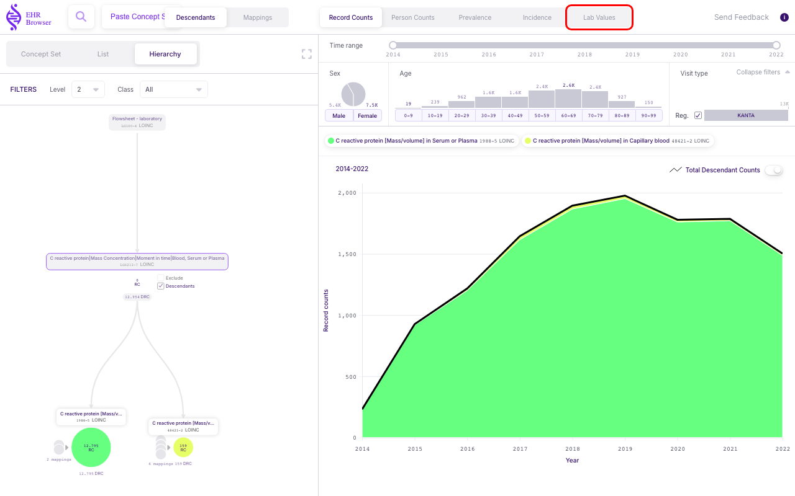
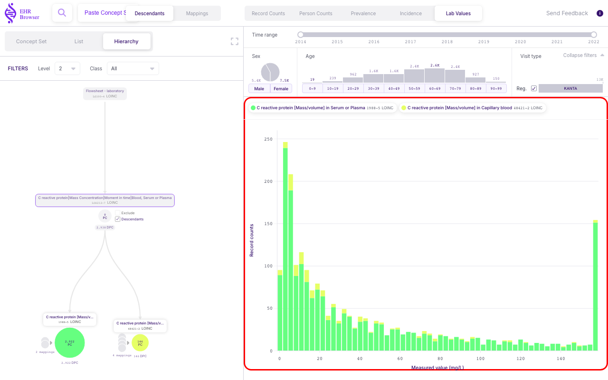

# Exploring a measurement Concept

Measurement **Concepts**, such as laboratory tests, can be explored in **EHRBrowser** like any other **Concept**: the hierarchy, list, record counts, person counts, prevalence and incidence work exactly as described in [Exploring a single Standard Concept](../1.Exploring_a_single_standard_concept/README.md). In addition, measurement **Concepts** have an extra **Lab Values** view, placed after **Incidence** in the top bar, which shows the distribution of the measured values.

This section uses the LOINC (Logical Observation Identifiers Names and Codes) group 'C reactive protein|Mass Concentration|Moment in time|Blood, Serum or Plasma' (LG6213-7, id 40652733) as an example. It has two children: 'C reactive protein [Mass/volume] in Serum or Plasma' and 'C reactive protein [Mass/volume] in Capillary blood'.

## Loading a measurement concept

Opening the **Concept** directly by its id (`/40652733`) and selecting **Hierarchy** gives the same page as for any other **Concept** (see [section 1](../1.Exploring_a_single_standard_concept/README.md)). The tree shows the selected **Concept** in the second level, under its parent 'Flowsheet - laboratory', with its two children below: 'C reactive protein [Mass/volume] in Serum or Plasma' (1988-5) with 12,795 RC (Record Counts), and 'C reactive protein [Mass/volume] in Capillary blood' (48421-2) with 159 RC.

The selected **Concept** itself has 0 RC, because it is a grouping **Concept**: all of its 12,954 DRC (Descendant Record Counts) come from its two children. Accordingly, the time plot on the right stacks the record counts of the two children for 2014–2022. The serum or plasma test (green) makes up almost all of the area, with the capillary blood test (yellow) as a thin layer on top.

## Lab Values view

Measurement **Concepts** show an extra **Lab Values** button in the top bar, after **Incidence**. It only appears when the selected **Concept** is a measurement.

Clicking **Lab Values** replaces the time plot with a stacked histogram of the measured values. The x axis shows the measured value with its unit (here mg/L), and the y axis the number of records falling in each value range. Each child **Concept** is a colour in the stack, as shown in the legend above the plot, so the value distributions of the two sub-measurements can be compared: most C reactive protein results fall at low values, under about 20 mg/L, with a long tail towards higher values, and the capillary blood results (yellow) add only a small part to each bar. A tall bar also appears at the right end of the scale.

The Sex, Age and Visit type filters above the plot work in the same way as described in [section 1](../1.Exploring_a_single_standard_concept/README.md) and filter the histogram.
