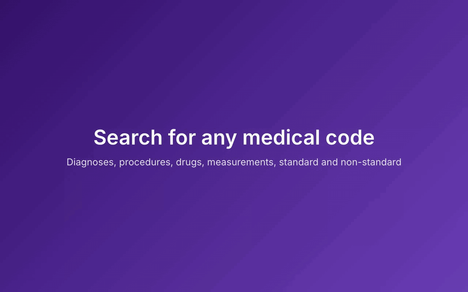

# EHR Browser v2.0.0

**EHR Browser** lets you look up any medical code in an OMOP-CDM database and see where it sits in the vocabulary hierarchy and how it is used over time, broken down by sex, age and visit type.

## What's new

- **Person Counts**: how many people have each code in the concept's tree, and how many share several of them
- **Prevalence**: share of the population with each concept, year by year
- **Incidence**: share of the population with a new case of each concept, year by year
- **Lab Values**: distribution of measured values for lab tests
- **New filters**: limit the plots to a time range, age or visit type, and use Level and Class to simplify large trees
- **User guide**: step-by-step guide with screenshots, in the handbook

